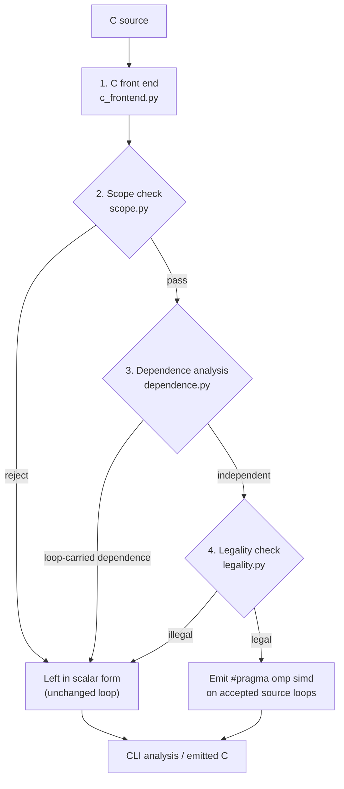

# Auto-Vectorizing Loop Optimizer

A source-level auto-vectorizing loop optimizer for Compiler Design (BCSE307).
AVLO analyzes real C source files, checks counted loops conservatively, and can
emit C annotated with OpenMP SIMD directives. A compact internal loop IR is
used by the analysis engine and its unit tests.

For supported loops, the tool:

1. parses C source into loop representations,
2. checks it is inside the supported shape,
3. decides whether its array accesses contain a **loop-carried dependence**
   using a simplified GCD / Banerjee-style offset comparison,
4. checks a set of **legality preconditions**,
5. annotates accepted C loops for SIMD compilation; unsupported or unsafe loops
   remain unchanged.

`--emit-c` adds `#pragma omp simd` to accepted loops so a normal C compiler can
generate SIMD code. AVLO does not claim a loop is vectorized when its supported
subset or dependence checks do not justify the annotation.

## Quick start

```bash
uv sync
uv run avlo examples/vector_add.c
uv run avlo examples/vector_add.c --emit-c /tmp/vector_add.simd.c
gcc -O3 -fopenmp-simd /tmp/vector_add.simd.c -o /tmp/vector_add
/tmp/vector_add
uv run avlo --json examples/recurrence.c
uv run pytest
```

The current C subset accepts counted `for` loops with constant non-zero induction
steps and runtime or constant bounds. Perfect counted-loop nests are analyzed at
the innermost loop; outer induction variables can appear in affine subscripts.
The parser supports one-dimensional accesses, fixed local multidimensional
arrays, common signed and unsigned integer types, floating-point expressions,
casts, and non-unit affine strides. Nested scalar `if/else` branches and `+` or
`*` reductions are supported. Conditional compilation, compound pointer
expressions, early loop exits, and general pointer alias analysis remain
unsupported. Fixed local multidimensional arrays are supported for inner-loop
vectorization when outer indexes match across accesses.
Pointer-to-pointer row accesses are rejected. Multiple unqualified pointer
bases are rejected when a cross-base access includes a write; same-base
accesses are analyzed normally. `restrict` lets AVLO treat distinct restricted
bases as disjoint according to the C contract; fixed local arrays are supported.
A small set of pure math calls is
accepted, including scalar user functions with a single side-effect-free return
expression; AVLO adds `declare simd` for those helpers. Other calls are rejected.
Unsupported constructs are reported and left unchanged.
The parser uses `pycparser`, not a compiler plugin. With `--emit-c`, AVLO adds
`#pragma omp simd` to loops it proves safe. Compile the output with OpenMP SIMD
support enabled in a regular C compiler; the compiler still selects actual
machine instructions.

All project examples are C programs under [`examples/`](examples). They cover
vector arithmetic, copies, reductions, branches, boundary trip counts, strided
and affine accesses, helper calls, and cases that must be rejected.

## Architecture and data flow

Three points can reject a loop and leave it in scalar form rather than
proceeding to the transformer.



Interface / data-flow between stages:

| Stage | Input | Output |
|---|---|---|
| C front end | C source | supported loop records (or source diagnostics) |
| Scope check | `Loop` | `ScopeResult` (ok / reasons) |
| Dependence | `Loop` | `DependenceResult` (verdict, pairs, distances) |
| Legality | `Loop` | `LegalityResult` (ok / reasons) |
| C emitter | Original C + accepted loop locations | C source with OpenMP SIMD directives |

## Pipeline and modules

| Stage | Module | Responsibility |
|---|---|---|
| 1. IR model | `src/avlo/ir.py` | Loop / statement / access / index data model and rendering |
| 2. Parse | `src/avlo/parser.py` | Text IR → `Loop`; affine index reduction |
| 3. Scope check | `src/avlo/scope.py` | Single-basic-block counted loop, known non-negative trip count |
| 4. Dependence | `src/avlo/dependence.py` | GCD / Banerjee-style offset comparison, RAW/WAR/WAW, distances |
| 5. Legality | `src/avlo/legality.py` | Affine non-broadcast accesses, supported ops, no unsupported constructs |
| 6. Transform | `src/avlo/transform.py` | Strip-mining, vector body lowering, remainder loop |
| Driver | `src/avlo/pipeline.py` | Wires the stages together and produces a `Report` |
| Execute / verify | `src/avlo/executor.py` | Runs the scalar loop and the vectorized output on identical inputs and compares |
| Output | `src/avlo/report.py` | Text and JSON rendering |
| CLI | `src/avlo/cli.py` | `avlo <file.c>` |

### Dependence test in one paragraph

For two accesses to the same array, the index expressions are reduced to
`c1*i + c0` and `c1'*j + c0'`. If `c1 == c1'` the equal-index equation gives an
exact dependence distance `d = (c0' - c0) / c1`; the pair is loop-carried when
`0 < |d| < trip`. If the coefficients differ, the **GCD test** is used as a
necessary condition: when `gcd(c1, c1')` does not divide `c0' - c0` the accesses
are provably independent, otherwise the simplified test cannot prove
independence and the pair is treated conservatively as possibly dependent.
Read-read pairs are skipped. In toy IR, distinct array names are assumed not to
alias. For C, the front end applies the pointer and `restrict` rules described
above before passing accesses into the dependence analyzer.

## Internal analysis tests

| ID | Category | Input | Expected | Actual | Result |
|---|---|---|---|---|---|
| T-01 | Positive | `c[i] = a[i] + b[i]` | VECTORIZED | VECTORIZED | PASS |
| T-02 | Positive | `c[i] = a[i] - b[i]` | VECTORIZED | VECTORIZED | PASS |
| T-03 | Positive | `c[i] = a[i] * b[i]` | VECTORIZED | VECTORIZED | PASS |
| T-04 | Positive | `b[i] = a[i]` | VECTORIZED | VECTORIZED | PASS |
| T-05 | Positive | `y[i] = alpha*x[i] + y[i]` | VECTORIZED | VECTORIZED | PASS |
| T-06 | Negative | `a[i] = a[i-1] + 1` | REJECTED | REJECTED — RAW, distance −1 | PASS |
| T-07 | Negative | `a[i+1] = a[i] * 2` | REJECTED | REJECTED — RAW, distance −1 | PASS |
| T-08 | Negative | body containing `foo(...)` | REJECTED | REJECTED — legality: function call | PASS |
| T-09 | Boundary | trip count < vector width | remainder loop only | vector_trip = 0, remainder = 3 | PASS |
| T-10 | Boundary | trip count not divisible by width | vector loop + remainder | vector_trip = 100, remainder = 1 | PASS |
| T-11 | Boundary | trip count = 0 | no-op, no crash | no loops emitted | PASS |

The analysis-engine taxonomy is encoded in
[`tests/test_taxonomy.py`](tests/test_taxonomy.py). Supporting unit tests live in
[`tests/test_ir_parser.py`](tests/test_ir_parser.py) (parser, affine reduction),
[`tests/test_dependence.py`](tests/test_dependence.py) (distances, GCD),
[`tests/test_transform.py`](tests/test_transform.py) (strip-mining partition) and
[`tests/test_cli.py`](tests/test_cli.py) (C CLI and loop-nest behavior). Run
`uv run pytest` for the unit suite and `uv run python scripts/e2e_c_examples.py`
to compile and compare every C example.

### Correctness

`executor.py` interprets both the original scalar loop and the emitted vector
program (`VLOAD` reads `V` consecutive elements, `VBCAST` broadcasts a scalar,
arithmetic runs element-wise, `VSTORE` writes `V` consecutive elements) over
identical, deterministically generated arrays and compares the results.
[`tests/test_executor.py`](tests/test_executor.py) asserts equality for every
positive case, across vector widths 1–8 and for trip counts smaller than, equal
to, and larger than the width — so strip-mining failures surface as failing
tests, not silent wrong output.

## Defect log

| ID | Symptom | Root cause | Correction | Status |
|---|---|---|---|---|
| D-01 | Every taxonomy test failed with `expected an identifier but found '['` | `_parse_factor` handled `id(` (calls) but not `id[` (array reads), so a right-hand-side reference was parsed as a scalar | Parse `id[ index ]` into a `Ref` in `parser.py` | Fixed |
| D-02 | A loop such as `c[i] = a[i] + i` vectorized wrongly | The transformer treated any `Scalar` as loop-invariant and emitted `VBCAST i` for the induction variable | `legality.py` rejects the induction variable used as a scalar value | Fixed (prevented) |
| D-03 | `c[2*i] = a[2*i]` would be lowered to contiguous `VLOAD` and compute wrong values | The vector executor originally assumed unit stride | Lane addresses now use the affine coefficient; constant-index broadcasts remain rejected | Fixed |
| D-04 | A dependence may be reported where a full solver would prove independence | The offset test cannot solve the two-variable Diophantine when coefficients differ; it falls back to the GCD necessary condition | Accepted simplification, documented under *Scope and limitations* | Known limitation |
| D-05 | README referenced `tests/test_units.py`, which no longer exists | The unit tests were split into per-module files | Corrected the references to the per-module test files | Fixed |

## Scope and limitations

Toy IR scope: counted loops, one-dimensional arrays, non-zero affine strides,
element-wise arithmetic, configurable vector width, scalar remainder loop,
execution and equivalence checking of the emitted IR.

C scope: the bounded subset described above, parsed with pycparser and emitted
as source with OpenMP SIMD directives.

Still out of scope: multidimensional pointer rows, arbitrary pointer alias
versioning, side-effecting calls, conditional compilation, and direct SIMD
instruction generation by AVLO.

Known simplifications:

* when coefficients differ the dependence test is conservative (it may report a
  dependence that a general solver would disprove);
* `vector_width` is a scalar knob, not a target cost model.

## C examples

Every runnable program can be analyzed and emitted with `--emit-c`. For example:

```bash
uv run avlo examples/saxpy.c
uv run avlo examples/recurrence.c
uv run avlo examples/branch.c --emit-c /tmp/branch.simd.c
uv run avlo examples/reduction.c --emit-c /tmp/reduction.simd.c
uv run avlo examples/step_strides.c --emit-c /tmp/steps.simd.c
uv run python scripts/e2e_c_examples.py
```

The end-to-end script compiles every example and compares the original program's
output with the emitted C. It requires GCC with OpenMP SIMD support. Low-level IR
unit tests remain for the dependence and transformation engine.
